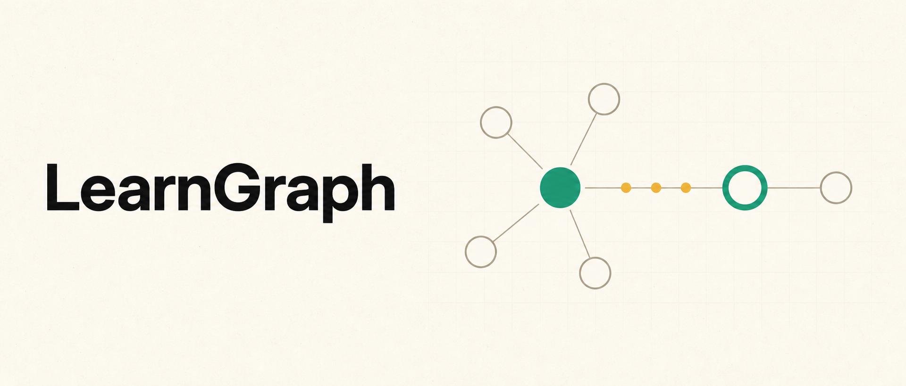
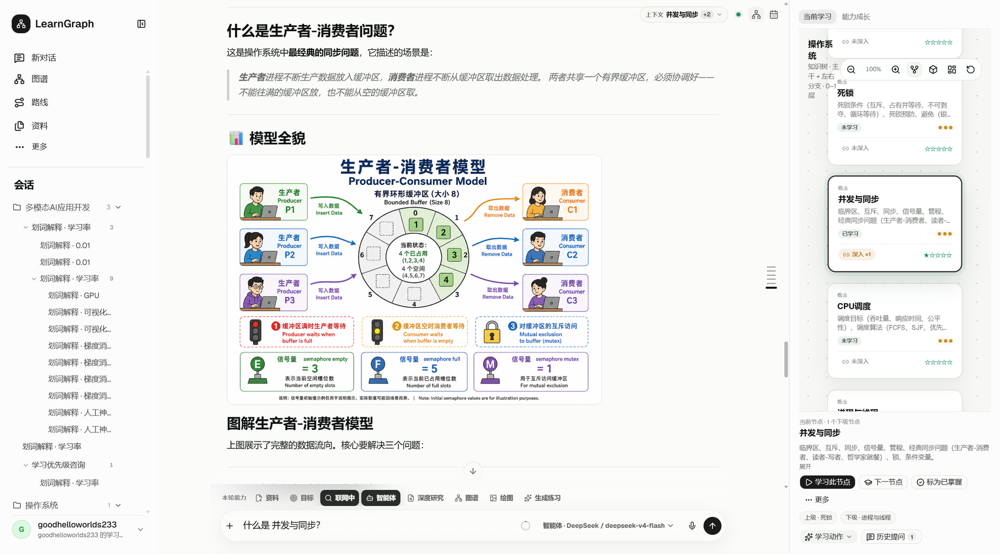
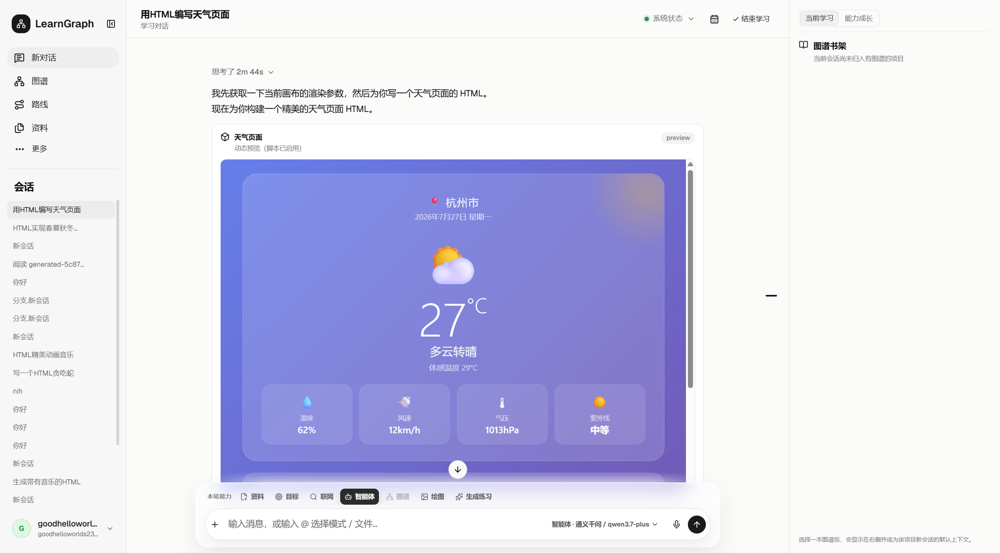
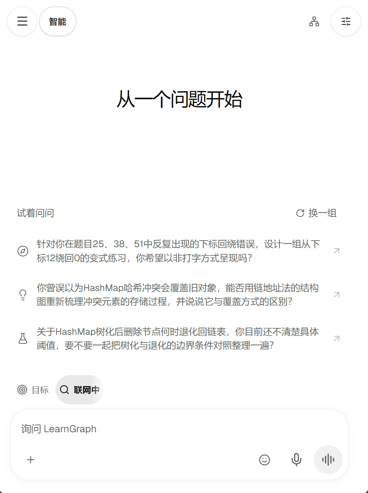
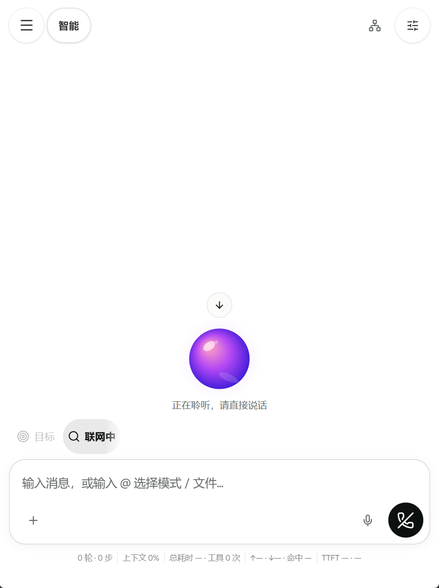
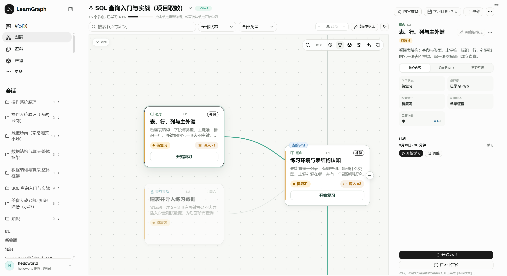
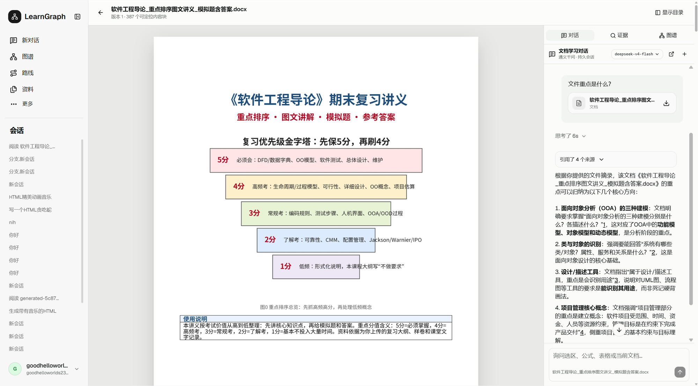

<p align="center">
  
</p>

<h1 align="center">LearnGraph</h1>

<p align="center">
  <strong>从一个目标出发，和 AI 一起学习、实践与成长。</strong><br>
  <span>知识图谱 · 学习 Agent · 长期记忆 · 实时语音</span><br>
  <span>Web + Android · Self-hosted</span>
</p>

<p align="center">
  
  
  
  
  <a href="https://sunnyboy-y.github.io/LearnGraph/"></a>
  <a href="./LICENSE"></a>
</p>

<p align="center">
  <a href="#-核心功能">核心功能</a> ·
  <a href="#-产品截图">产品截图</a> ·
  <a href="#-快速开始">快速开始</a> ·
  <a href="#-技术架构">技术架构</a> ·
  <a href="#-开发与检查">开发与检查</a> ·
  <a href="https://sunnyboy-y.github.io/LearnGraph/">开发者文档</a>
</p>

> [!IMPORTANT]
> 项目处于早期开发阶段，适合体验、研究和共同开发。请勿用于生产环境。

## ⚡ 核心功能

| 功能 | 能做什么 |
| --- | --- |
| 🌱 **学习图谱** | 描述目标后生成知识路线，审核和调整节点；练习、对话与实践产生的证据持续更新能力状态和下一步建议。 |
| 🤖 **学习 Agent** | 结合资料、工具和记忆讲解知识、设计练习、执行代码与整理研究成果。支持多种模型、Skills、MCP 和子任务。 |
| 🎙 **全双工语音** | 边说边听、随时打断；字幕随朗读逐句点亮。语音和文字共用会话、记忆与学习证据，Android 端也可使用。 |
| 🧩 **交互式学习** | 从图谱节点生成教材、互动实验、小剧场和闯关测评；交互组件和子应用中的操作可反馈给 Agent。 |
| 🔎 **资料与研究** | 阅读上传的文档和媒体，联网搜索并引用来源；通过 OpenAlex 或 arXiv 检索论文、读取公开 PDF、保存引用并导出 BibTeX。 |
| ⏱ **长程与定时任务** | 用 `/goal` 在会话中启动可暂停、继续的多轮任务；定时任务可按计划执行已授权的 Skill 或 MCP 工具。 |
| 🧠 **长期记忆** | 学习过程和来源形成可追溯记录，按当前任务检索并装配到上下文；支持记忆治理。 |
| 🛡 **隔离沙箱** | Agent 在 Docker 沙箱中执行代码和处理文件；默认断网，联网需经过授权。 |
| 📱 **Android 客户端** | 用手机连接自己的工作区，支持拍照、分享、扫码、文件下载、通知和语音。 |

### 一次学习流程

1. 说出学习目标，审核生成的知识图谱。
2. 围绕图谱节点与 Agent 对话，阅读资料、完成练习或动手实践。
3. 系统记录学习证据，更新能力状态并推荐下一步行动。

## 🖼 产品截图

<table>
  <tr>
    <th width="50%">主对话工作台</th>
    <th width="50%">双向交互子应用</th>
  </tr>
  <tr>
    <td></td>
    <td></td>
  </tr>
  <tr>
    <th>Android 移动端</th>
    <th>双工语音交互</th>
  </tr>
  <tr>
    <td></td>
    <td></td>
  </tr>
  <tr>
    <th>学习图谱</th>
    <th>文档学习与溯源问答</th>
  </tr>
  <tr>
    <td></td>
    <td></td>
  </tr>
</table>

## 🚀 快速开始

### Docker Compose（推荐）

安装 [Docker](https://www.docker.com/) 后执行：

```bash
git clone https://github.com/SunnyBoy-y/LearnGraph.git
cd LearnGraph
docker compose up -d --build
```

访问 **http://127.0.0.1:18000**，使用容器日志中首次打印的管理员临时密码登录，用户名为 `admin`。首次登录后请修改密码。

| 地址 | 用途 |
| --- | --- |
| `http://127.0.0.1:18000` | Web 与 API |
| `http://127.0.0.1:18001` | 交互式子应用预览 |
| `http://127.0.0.1:18000/api/v1/health` | 健康检查 |

默认 Demo 账户处于禁用状态。本地体验需要时，在根目录 `.env` 设置 `LEARNGRAPH_ENABLE_DEMO_LOGIN=true`，再执行 `docker compose up -d --force-recreate app`。

默认数据保存在 Docker 数据卷。备份、局域网和公网访问、宿主机服务连接及应用内更新见 [部署与更新](docs/deployment-and-updates.md)；环境变量见根目录 `.env.example`。

### 源码开发

需要 Node.js 20+、npm 10+、Python 3.11+ 和 [uv](https://docs.astral.sh/uv/)。沙箱功能需要 Docker。

```bash
git clone https://github.com/SunnyBoy-y/LearnGraph.git
cd LearnGraph
npm run dev:install   # 首次安装依赖并启动
npm run dev           # 后续启动
```

前端默认地址为 `http://127.0.0.1:5173`，API 为 `http://127.0.0.1:8000`，接口文档为 `http://127.0.0.1:8000/docs`。启动脚本会在配置文件缺失时从 `.env.example` 创建。

### Android 客户端

Android 客户端采用 Kotlin、Jetpack Compose 和 GeckoView，连接已部署的 LearnGraph 服务。局域网使用时，服务需监听 `0.0.0.0`，并在手机端输入电脑的局域网地址，例如 `http://192.168.x.x:18000`。构建与安装见 [Android 客户端说明](mobile/native/README.md)。

### 配置语音

在工作区配置实时语音识别、语音合成和对话模型。目前语音识别适配阿里 DashScope，语音合成适配火山引擎 TTS 2.0。语音数据会发送给对应的云端服务商。

浏览器使用麦克风需要 `localhost` 或 HTTPS；通过局域网 IP 或公网地址访问时请配置 HTTPS。Android 客户端会申请系统录音权限。语音可用于对话、练习和委派后台任务，具体能力取决于工作区配置与授权。

## 🏗 技术架构

```text
Web: React + TypeScript              Android: Kotlin + Compose + GeckoView
                         │
                  FastAPI 后端
       ┌─────────────────┼──────────────────┐
   学习图谱与证据     Agent / 语音 / 记忆     Provider / MCP / Skills
       └─────────────────┼──────────────────┘
                Docker 沙箱与受控出网
```

业务数据默认存储在 SQLite（WAL），系统管理员可迁移至 PostgreSQL。会话消息、流事件和记忆事件持久化保存。后端负责身份认证、工作区授权和 Provider 调用。

| 目录 | 内容 |
| --- | --- |
| `frontend/` | Web 界面 |
| `backend/` | API、学习服务、Agent 和 Provider 适配 |
| `sandboxd/` | 沙箱控制服务 |
| `mobile/native/` | Android 原生客户端 |
| `docs/` | 功能与开发文档 |

沙箱默认隔离网络，外部资源和工具调用遵循授权范围。更多细节见 [开发者文档](https://sunnyboy-y.github.io/LearnGraph/)、[联网研究](docs/web-tool-supplements.md)、[论文检索](docs/paper-search-and-library.md)、[长程任务](docs/chat-goals.md)和[定时任务](docs/skill-mcp-schedules-verification.md#定时任务)。

## 🧪 开发与检查

| 命令 | 作用 |
| --- | --- |
| `npm run dev` | 启动前后端 |
| `npm run dev:install` | 安装依赖并启动 |
| `npm run check` | 执行前端、后端和 sandboxd 检查 |
| `npm run check:frontend` | 执行前端检查 |
| `npm run check:backend` | 执行后端检查 |
| `npm run build:frontend` | 构建前端 |
| `npm run docker:up` | 生成配置并启动 Compose |

Android 原生客户端测试和构建命令见 [Android 客户端说明](mobile/native/README.md)。

## 🤝 参与贡献

欢迎提交 [Issue](https://github.com/SunnyBoy-y/LearnGraph/issues) 或 Pull Request。技术细节见[开发者文档](https://sunnyboy-y.github.io/LearnGraph/)。

## 📄 License

LearnGraph 基于 [MIT License](./LICENSE) 开源。

## 🙏 鸣谢

感谢 [CC-Switch](https://github.com/farion1231/cc-switch) 的开源贡献。GitHub Copilot 接入及部分供应商快捷配置参考了其预设与适配工作。

## 友情链接
学AI上L站！
[Linux DO](https://linux.do/)
