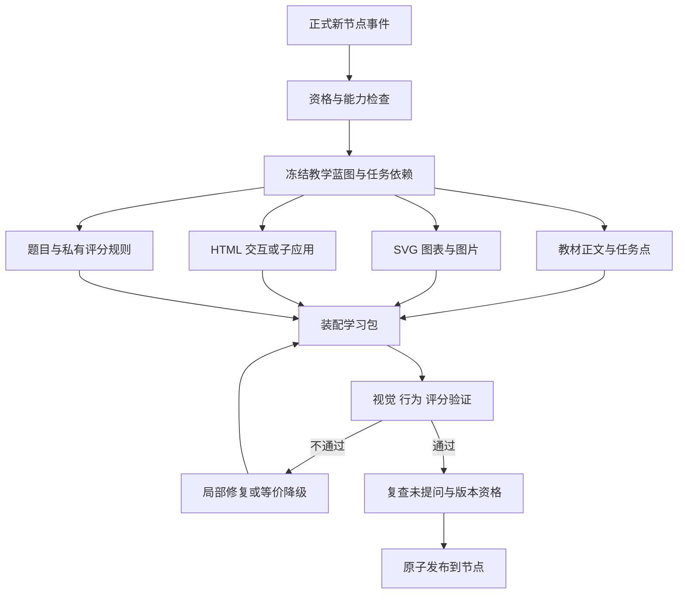

# 图谱学习内容自动生产管线

状态：设计方案已附带前后端实现。当前实际接入范围与验证结果见《node-learning-implementation.md》；下文的多文件构建器、自动视觉评审等扩展接口仍为演进设计，不能当作已经运行的能力。本次未调用外部模型或生图服务。
依据：2026-09-17 本地代码。下文“已具备”表示有对应实现，不代表当前部署已配置模型或已开启相关功能。

## 1. 总体方案

建立 Learning Build Orchestrator（学习内容构建编排器）：把一个符合条件的新节点转为教学蓝图，再自动选择 SVG、图表、生图、受控题目组件、HTML 卡片或多文件子应用，分任务生成、校验、修复，装配为一个不可变的学习包。

预构建不依赖聊天窗口保持打开，也不需要为每张图、每个组件再次点击生成。用户开启图谱策略后，系统按授权范围和预算自动运行。学习页主体由受控教材组件渲染；复杂互动以隔离子应用嵌入。

图中并行是未来后台任务的执行关系，不要求为每个步骤启一个独立模型智能体。默认是一个编排器、明确的生产适配器和持久任务。

## 2. 现有能力如何复用

### 2.1 SVG 与图表

已有 `backend/app/skills/node_learning/SKILL.md` 及 `references/orchestration.md` 定义了 L1 SVG、L2 图表、L3 自测、L4/L5 交互动画与 L6 图片的选型。SVG 是模型生成代码、沙箱保存和渲染的组合能力，没有必要假设存在一个单独的“SVG 生图 API”。`AgentToolRuntime` 已路由 `create_chart` / `read_chart`。

新增 `SvgProducer`：先产 diagram_spec（节点、连线、标注、单位），再生成 SVG。注册模板优先，自定义 SVG 次之。把 SVG 当作待验证代码，不能沿用技能中“自绘不会画错”的字面假设。

检查 XML、viewBox、元素/文本范围、连线目标、标签重叠与单位；禁止脚本、事件属性、foreignObject 和未批准外链。复杂 SVG 在隔离环境预览；经过净化的静态结果才进入教材。精确坐标、结构和数值不能交给扩散生图代替。

### 2.2 图片生成

已有 `generate_image`、`ImageGenerationService`、`ImageGenerationTask`、`FileRecord` 和 `ImageGenerationProviderPort`。复用模型选择、输入图校验、生成流、费用记录与文件保存，不另接一套供应商。

但 `ImageGenerationService.create` 当前要求 session/message/version/source_message 标识，图片引用默认挂在 message 上；后台教材没有真实用户消息，必须增加 build_run 的归属适配，不能编造用户问题。

图片生产输出 `file_id + sha256 + caption + alt + provenance`。仅接受 completed 结果作为发布素材；现有 partial/final 流可能更新同一 FileRecord 的 object_key，教材必须冻结最终内容哈希和不可变版本，避免流式中间图被永久引用。

图片使用顺序：已有授权素材 → SVG/图表能否准确表达 → 必要时生成插画。需要真实证据照片时，只能用授权资料或允许联网时的真实来源；没有来源就标缺失，不能生成一张“看起来真实”的图当证据。本次设计与验证不联网；未来构建按工作区策略明确区分模型服务出站与网络检索授权。

### 2.3 受控题目组件

已有 `canvas_emit_trusted_component` 与 `frontend/src/components/chat/trusted-component-renderer.tsx`。普通选择、填空、短答优先复用组件与 Exercise 系统。

现有 node-learning 技能允许训练组件携带答案并在前端即时判分。正式考试必须使用新的公开题目投影和服务端评分，不直接把该训练 payload 搬入试卷。生成时同时产公开题面与私有答案两个隔离产物。

### 2.4 单文件 HTML 交互卡

已有 `canvas_emit_magic_card`、`backend/app/services/canvas_cards.py`、`ArtifactCardService` 与沙箱 HTML 宿主。适合翻卡、步骤动画、变量小实验；当前 HTML 上限 100,000 字符，禁止远程资源与联网代码，普通表单仍使用受控组件。

新增 `HtmlCardProducer` 输出完整自包含 HTML，复用验证/隔离渲染及不可变版本能力。后台适配直接返回产物引用，不向学习者聊天插入 MessagePart。涉及可计分进度时，必须另接明确的活动事件契约；只有动画的 HTML 不能宣称可产生可信完成证据。

### 2.5 多文件子应用

已有 `frontend-build-preview` 技能及 `scaffold_vite.py`、`build_frontend.py`、`render_preview.py`、`check_static_assets.py`；宿主提供 `sandbox_validate_web_app`、`sandbox_validate_interaction_contract`、`sandbox_publish_web_app`。

已有 `SubAppBundleService`、`SubAppService`、`SubAppSession`、状态版本与事件记录；前端注入 `window.__lgSubapp`，支持 submit / track / onState / onStatus。

生产链采用：受控模板/源码 → 沙箱构建 dist → 资源检查 → 页面验收 → 交互契约检查 → 不可变 bundle → 学习包引用。生成源码不能获取宿主 DOM、数据库凭据或供应商密钥。

当前须适配的事实：

- bundle 校验/发布仍绑定 chat_session_id，而运行时 SubAppSession 已允许 chat_session_id 为空。构建上下文需要独立建模。
- `SubAppBundleService.publish` 返回的 `artifact_version_id` 实际是 ComponentManifestVersion ID；它不等于 ArtifactCardVersion / 文件 ArtifactVersion ID。学习包必须使用有判别字段的引用，禁止把这些 ID 混用。
- 当前 bundle 验证额度为最多 256 文件、单文件 8MiB、总计 32MiB；契约与校验票据也有独立限制。技能中的构建额度不能当成发布额度，实际有效预算取各层允许值的较小者。
- 当前 `_validate_entry_html` 拒绝 iframe、form、base 等入口标记。题目输入可以使用 input/button 及 SDK 提交；不能让生成器写原生 form 后期待现有发布器接受。
- 现有技能要求无外链，而 `_validate_entry_html` 允许部分 http(s) 引用；离线教材管线必须额外明确执行 no_external_assets 检查，不能假设现有发布器已封住所有网络依赖。
- 当前 contract_smoke 在失败/跳过时不一定阻止发布，它只尝试合成并验证事件样本，不证明页面点击后确实产生正确事件。本管线新增强制浏览器行为与 ACK 验证。

## 3. 先产教学蓝图，再决定技术形态

新增 `LearningBlueprint`，由节点定义、teaching_strategy、必要前置快照、学习目标、授权资料与能力快照生成。输出必须有：

- objectives：可观察目标、重要性、验证方式。
- sections：章节、概念、例题/反例、资料引用。
- visual_briefs：每个视觉要解释什么、必须正确的标注、素材来源与表现形式。
- activity_briefs：初始状态、允许动作、可观察反馈、成功/失败路径、是否必做。
- assessment_blueprint：目标覆盖、题型、难度、分值、关键项与评分策略。
- task_graph：学习者任务点及其依赖。
- production_graph：生产任务依赖、预算、输出类型与降级路径。
- style_tokens：继承 LearnGraph 字体、颜色、间距、插画风格、深浅色与移动端约束。

**学习任务图与生产任务图是两个不同对象**。用户完成实验记到 progress；后台生成实验完成记到 build_task，绝不能串用完成状态。

教学决策由模型给出理由，执行选择由服务端校验白名单、配额与真实能力。能力清单包含版本、可用性、输入/输出 schema、所需权限、预算、验证器和降级能力。能力不可用在调用前发现，不盲目调用再无限重试。

## 4. 内容路由规则

1. 定义、边界、反例：教材块 + SVG 示意 + 即时自测。
2. 比例、曲线、分布：有来源的数据 + 图表；没有数值不得为了图文并茂编造统计。
3. 结构、流程、算法执行：SVG/HTML 分步演示；确有变量探索时加入控件。
4. 需要外观辨识：复用授权图片；可用插画表达的场景才选择生图。
5. 简单顺序、分类、变量训练：注册交互模板 + JSON 参数，优先避免从零写应用。
6. 多场景、复杂状态、可复盘小游戏：沙箱生成子应用，强制活动契约与验证规格。
7. 正式考试：宿主试卷组件 + 服务端题目/评分；实践题引用特定子应用版本，以独立考试实例启动。

每个视觉或交互都有 objective_ids。没有教学目标的装饰不自动增加费用。不会把所有节点都升级成重型小游戏，也不因为只产文字更便宜就把实验退化成长说明。

## 5. 执行阶段和完成判据

### S0：接收与快照

收到正式节点发布 outbox；严格复查旧节点/已问过排除规则。冻结 node_fingerprint、policy_epoch、eligibility_version、source_versions、audience_scope 和 provider/capability 版本。预算先预占，任务幂等入队。

### S1：教学规划

产蓝图并做目标覆盖、资料充分性与任务依赖无环检查。来源不足但不影响基础解释时加 provenance 标记；依赖不可确认事实的核心内容进入 needs_sources，不生成伪引用。

### S2：规格冻结

规划器把每个产物编译成有明确 adapter 的生产任务。冻结 diagram_spec、interaction_spec、试卷蓝图及 design tokens。题面、插图、实验共用同一术语和对象 ID，减少各自产生不同版本的概念。

### S3：分支生产

正文、SVG/图表、必要图片、实验和题库可按依赖并行。每任务写 checkpoint、产物 hash、用量与错误。图片未完成不阻塞正文编写，但最终装配必须解析所有必需引用。

### S4：构建与静态检查

SVG 解析，HTML 净化/策略检查，子应用编译，入口与资源闭合校验，公开/私有考试字段分离，题目总分/目标覆盖验证。正式 bundle 内不包含私有答案、测试密钥或评分阈值全集。

### S5：运行与教学验收

真实隔离预览下检查桌面/移动端、亮暗模式、文字可读性、资源加载、JS 错误、键盘操作、交互重置与持久 ACK。使用合成学习者和专用 QA 运行域，不产生真实 first_engaged、成绩、证据或徽章。

必须演练至少一条成功路径、一条错误路径、一次状态保存恢复、一次重复事件；考试还需验证答案不泄漏、关键项失败不通过。截图证明画面，行为日志证明交互；模型看截图不能替代事件断言。

### S6：装配

将通过校验的版本引用填入 LearningPackage manifest；检查全部 required learning tasks 均有执行器和验证方式。可选配图失败可以明确降级；必做实践未可用时整个包不得标 ready。

### S7：发布

产物先处于构建私有的 staged 状态，再复查租约、权限、开关 epoch、node_fingerprint 与未交互资格。在同一业务提交中切换 package 状态和 current_package_id，并发布完成事件。用户开始学习与发布竞争同一 eligibility_version。

素材库存入库不等于学习页发布，也不自动产生公共分享链接。需要在 Artifact/SubApp 查询和 preview grant 签发处检查 staged 可见性，不能只靠前端隐藏列表。

## 6. 实验与子应用的生成规格

新增 `ActivitySpec`：activity_id、objective_ids、initial_state、state_schema、actions、transition_rules、observations、completion_predicates、reset_policy、mode、version。服务端验证器只从受控 DSL / 已注册函数读取规则，不 eval 模型生成任意代码。

生成模型负责场景排版、交互表达和素材布局；领域规则优先用可检查的 JSON 状态机或官方模拟模板。没有可验证核心规则的自由生成小游戏只能用于探索，不能自动发正式通关证据。

三个产物分开：

- `ui/`：HTML/CSS/JS、图片等，进入客户端 bundle。
- `learngraph.subapp.json`：官方 SDK 事件与公开状态 schema，闭包且版本化。
- `assessment_private`：目标判定、隐藏测试、评分量表，仅进入服务端私有存储，绝不放入 dist。

页面只通过 `__lgSubapp.submit(...)` 提交；只有 persisted ACK 才显示“已保存”。该 ACK 只证明入库，不代表答对或通过。宿主把 session 绑定到真实的 user/node/package/enrollment/attempt，拒绝前端传入其他用户的绑定 ID。

事件推荐复用 `answer.submitted`、`hint.requested`、`step.completed` 等既有命名。新增事件需进入注册字典。高频滑块/输入统计仅 analytics，不触发模型；实验结果提交由确定性消费者验证，导师讲解按既有 Agent 开关与授权执行。

契约例中业务 payload 不包含事件类型 type；事件名使用 submit 的第一个参数。顶层 event/state schema 必须 additionalProperties:false，禁止任意外部 ref 与 HTML/JS 字段。

训练与考试共享 UI 引擎，但分开配置、尝试和服务端状态。训练提示、答案与教师调试界面不能只用 CSS 隐藏后留在考试 bundle。考试允许本地显示操作轨迹，权威动作和最终结果由服务端重放确认。

当前 `subapp_event_agent` 有功能开关和 consent 机制；预构建开关不替用户打开 Agent 自动对话权限。确定性判分不得依赖该开关，因此需要新增 learning_event_consumer 处理学习提交，已有 Agent 只承担被允许的辅导。

## 7. 一个“辣椒炒肉”节点会自动产什么

1. 蓝图识别目标：理解分步处理、根据材料状态选择下一步、完成一轮正确流程。示例是简化模拟，不以图像推断真实食品安全。
2. TextProducer：生成短教材、术语、反例、总结与任务点。
3. SvgProducer：生成材料处理流程和操作反馈标注；文字标注保留为可编辑文本。
4. ImageProducer（可选）：生成统一风格的材料插画或锅台背景，最多按该节点预算生成一次；无法生图时用验证后的 SVG 示意完成同样作用。
5. ActivityProducer：选择 sequence_simulator 模板；ActivitySpec 定义锅内状态、火力选择、动作先决条件、观察反馈和结束条件。后续确需多场景或复杂动画时再提升为自定义子应用。
6. SubAppProducer：模板装配生成真实可操作应用，并嵌入官方 SDK；不把任务完成设计成每按一次“下一步”加分。
7. AssessmentProducer：按目标配比生成选择、判断、填空与实践题；大题按需要加入，私有评分规则独立保存。
8. QA：验证至少一条正确流程、几条非法转移、必要条件缺失不能通关、错误后可恢复；独立检查规则是否符合教学蓝图，不能只测试生成器自己写出的预期。
9. Assembler：绑定教材章节、图、实验入口、任务点和测评入口。新节点展示“已准备”，学习者完成正式评测后才得到金边。

这条管线同样用于“二分查找”：材料与锅具换为数组 SVG，交互换为左右边界选择，服务器重放区间缩减；不需要为每个领域维护独立的全站应用。

## 8. 输出契约与引用关系

新增 `BuildTaskResult`，通用字段：run_id、task_id、attempt_id、producer_version、status、input_hash、outputs、quality_report_ref、usage、diagnostics、fallback_used。outputs 只存版本化引用和 hash，不存过期预览 URL。

新增有判别字段的 `LearningArtifactRef`：

- `file`：file_id + immutable_file_version + sha256，供图片、SVG、静态导出使用。
- `card`：card_id + card_version_id，供固定 HTML 卡片版本使用。
- `subapp`：bundle_id + component_manifest_version_id + bundle_sha256；运行时 session_id 另存，不属于共享教材。
- `exercise_set`：question_set_version_id；公开题目读取与私有评分读取分离。
- `chart`：chart_version_id 或已验证图表 spec 快照，包含来源/单位。

这些为新增学习包协议名称，适配器必须显式转换现有服务返回值。缺少不可变文件/图表版本时，应先创建快照，不把当前可变 file_id 当作冻结版本。

package manifest 包含 sections、objectives、artifact_refs、learning_tasks、assessment_blueprint_ref、fallback_notes、provenance、schema_version、renderer_min_version；每个 block_id/task_id 引用可追溯到蓝图和生产任务。

## 9. 数据与后台上下文

沿用主方案的 learning_build_runs / node_learning_packages 等逻辑表，再补以下字段/结构：

- **learning_build_tasks**：run_id、task_key、adapter_id、dependencies、status、input_hash、attempt、lease_ref、budget_reservation_id、output_refs、stage_checkpoint、error_code。唯一键 (run_id,task_key,input_hash)，任务尝试另有唯一 attempt_id。
- **learning_build_contexts**：workspace_id、actor_id、audience_scope、build_run_id、sandbox_workspace_ref、capability_snapshot、source_access_snapshot。没有用户问题语义，不参与首次学习标记。
- **learning_artifact_bindings**：package_id、block/task_id、有类型的 artifact_ref、sha256、required、objective_ids。
- **learning_quality_reports**：run/task/input hashes、validator_version、自动检查项、失败证据、截图/事件日志引用与是否阻断发布。
- **learning_runtime_bindings**：subapp_session_id、user_id、node_id、package_id、task_id、attempt_id、mode、validator_version。运行实例只服务一个明确学习者。
- **learning_production_usage**：预算预占、供应商请求 ID、已知用量、待确认消耗、取消与退款状态。后台任务状态与供应商账单状态分别记录。

优先把 SessionWorkspace/ImageGeneration/Artifact 创建服务抽出 `owner_context`（chat 或 learning_build）的公共内核，保留现有聊天适配。数据库字段与外键需兼容迁移，不能只把 session_id 参数置空绕过限制。

过渡如必须复用 ChatSession，应增加正式 `purpose=learning_build` 类型，排除会话书架、通知、消息数、学习历史和记忆抽取，并由所有资格查询识别；这是一项显式迁移方案，不是在后台偷偷创建假用户对话。正式目标仍是独立 build context。

## 10. 调度、重试与成本

使用现有 DurableJob；父任务只负责编排和汇合，子任务各有 checkpoint/lease。父任务等待子任务时释放 worker，不持有数据库事务等待模型或生图。每次调用前预占成本；分支完成后结算。

一次远程生图/模型调用的请求 ID 在发起前记录。供应商支持幂等键则复用；不支持且超时结果未知时记 awaiting_reconciliation，先查询/等待，不承诺 exactly-once 计费，也不盲目重发。

缓存键至少含 workspace/audience/source ACL、语义规格 hash、producer/model/prompt/schema/renderer 版本、输入图片 hash。缓存命中只复用授权范围内的不可变产物，不能复用任何学习者进度、私有测评答案到公共展示或跨工作区泄漏资料。

默认建议：每工作区一个构建 run 活跃，同 run 内轻量任务最多两个并行；生图最多一个请求，主交互最多一个；局部修复最多两轮。数值是初始配置建议，最终受宿主/供应商更严格的额度限制。正式关卡题数不套用聊天技能“1–3 道自测”的限制，而由评分蓝图决定。

重复任务、模型重试、修复、降级共享 run 总预算，不能通过新建子任务重置费用上限。用户关闭开关后停止派发，等待中/运行中任务在安全点结束，迟到结果不得绑定节点。

## 11. 故障与降级规则

自动修复只提交当前失败产物及诊断，保留通过产物，防止每次重跑整个教材。每次修复生成新 attempt 和产物 hash，旧记录可追溯。

- 可选插画失败：使用已验证 SVG 或已有资料图，标注实际替代形式；不输出空图片槽。
- SVG 布局失败：先修复布局，再使用相同结构的标准图模板；无法表达关键关系则阻断该必需章节。
- HTML 交互运行失败：退回等价注册交互模板；不能用一段文字替代必做实验后仍声称“实验已准备”。
- 自定义子应用构建失败：降级到能覆盖相同目标的状态机模板；缺少可验证模板则 needs_review/blocked。
- 题目或评分校验失败：只重建对应题目；分值/覆盖不足阻断考试发布，不偷偷减少题目。
- 模型能力不可用、权限不足或资料缺失：waiting_capability / needs_sources，停止耗费，不以演示内容顶替真实学习包。
- 最终发现节点已被问过、已删除或输入变更：skipped，不归类为生成质量失败，不自动覆盖学习者当前版本。

optional 分支失败不自动影响 required 分支，但必须记录 skipped_optional 与原因。required 失败必须由通过同一目标校验的替代产物解决，否则包不 ready。

## 12. 技能与产品行为需要同步调整

现有 node-learning 是“选中节点后在聊天教学”的技能，且静态页仅按需产出；不能直接把它原封不动放进定时任务。建议新增应用内技能 `learning-package-build`（待实现），继承其素材选型与教学模板，输入改为冻结 Blueprint，输出改为产物引用和质量报告。

技能负责如何生产，调度与权限仍由服务端控制。应用内技能不可自行改开关、改变节点资格、发掌握度证据、开启公共分享、开通网络或绕过发布校验。

建议交付三个 profile：

- `concept_package`：教材 + 解释性图 + 自测，必要时轻交互。
- `practice_package`：实验说明 + 可验证交互 + 复盘 + 出口测。
- `assessment_package`：试卷说明 + 公共题面/实践卡 + 私有评分与通关标准。

页面“准备中”可展开真实流水线：教学设计 / 图文素材 / 实验构建 / 测评题目 / 检查发布；给出失败项、降级说明和重试入口。后台模型文本不刷进聊天，只有用户展开诊断时才显示必要细节。

## 13. 最小实施拆分与验收

第一阶段：build context、能力快照、DAG 子任务、Text/SVG/受控题目适配器、版本引用和原子发布；至少完成一条知识节点生产链。

第二阶段：Image/HTML/SubApp 适配、官方 SDK 事件、独立学习消费器、公开/私有评分隔离；完成一个真实实验节点和正式评测。

第三阶段：自动视觉检查、失败局部修复、目标等价降级、预算与缓存、批量可观测性。

必须通过的集成案例：

1. 一个正式新节点在没有打开聊天窗口时自动产出可读、可操作、可评分的学习页。
2. 后台所有产物不增加用户消息数，也不把节点误记成已问过。
3. 一张图失败，只修该图；核心实验失败则不能发布成完整包。
4. 使用真正注入的 SDK，操作入库收到 ACK，刷新后从宿主状态恢复；不能只验证 DOM 按钮变化。
5. 浏览器伪造“满分/完成”事件不会发成绩；重复提交、迟到提交、重放和跨用户 ID 都有明确结果。
6. 客户端 bundle/网络响应/导出文件均无私有标准答案；训练和考试实例相互隔离。
7. 生成途中用户开始提问，或关闭开关，或更改节点内容，旧任务都不能晚发布覆盖。
8. 存量用户提问、旧节点及未授权资料不会被自动批量构建。
9. worker 在远程调用返回前后崩溃可以恢复；未知远程结果不会导致无界重复费用。
10. staged 产物不能从普通产物页、猜测 bundle ID 或申请 preview grant 提前读取；发布后按原有授权边界可见。
11. 子应用内资源能在承诺的无外链模式下完整加载；“可离线查看资源”与“离线提交成绩”分别标注，后者未同步时不显示已提交。

配套 `examples/learning-build-plan.v1.json` 是待实现调度器的设计样例，不是当前系统可以直接执行的配置。适配器 ID 与端口名称为本方案新定义；上线前必须补齐注册实现及 schema 校验。
