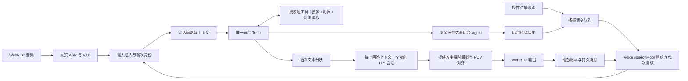

# 全双工语音修复与验收（2026-10-21）

> 后续状态：已完成实际 18000 部署、专用天气/新闻源及生产语音验收，详见 [生产验收报告](production-information-acceptance-2026-10-21.md)。以下保留此前隔离阶段的原始结果与未通过项，不代表最新部署状态。

代码已融合现有 Voice Session / Pipecat / AgentToolRuntime / Journal / Message 路径。验收在独立容器 `learngraph-voice-acceptance:18002` 和前端 `127.0.0.1:5174` 上进行，使用克隆数据库与真实配置的提供方。原服务 `18000` 未部署这些改动，健康检查通过。

## 实现链路

### 四项问题的处理

| 问题 | 集成后的行为 | 关键实现 |
|---|---|---|
| 固定“嗯 / 我想想” | 移除 250 ms 固定应声及工具调用即时口头确认；默认会话策略使用活动状态反馈。延迟反馈处理器仅在策略允许、尚无正文且用户未说话时提供一次实际进度；模型提示约束贴题回应 | `response_feedback.py`、`conversation_control.py`、`embedded_bot.py` |
| 控件抢音 | 控件通过独立 RTVI 请求排队；与后台结果共享同一个发言权状态。数据库 IO 后与消费入口都复核租约；模型结束或短暂 BotStopped 不代表音频已播完 | `speech_floor.py`、`embedded_result_bridge.py`、前端 `voice-session-controller.tsx` |
| 碎句与长停顿 | 文本分块不再等于 TTS 会话/字幕边界；同一回答持续向同一双向会话送文本。使用真实字幕时间戳对齐 PCM，保留每个采样和原有静音；缺失/非法时间戳显式失败 | `embedded_tts_aggregator.py`、`embedded_volcengine_tts.py`、`tts_alignment.py` |
| 工具不自然或丢失 | 普通天气/新闻直接调用短查询工具，复杂工作走持久委派。激活与重新激活都使用同一个合并工具目录，保留权限边界、调用身份、状态、来源与取消语义 | `TutorAgent.build_tools()`、`_foreground_text_tool_schemas()` |

TTS 未采用另一种合成实现、猜测时间戳或吞掉失败继续播报。保留的是同一协议上的有限连接/会话释放重试。工具目录加载失败直接暴露错误，不以空工具目录继续装作正常。

后台结果通过显式 `origin=delivery` 的 assistant-only 轮次进入现有账本和消息存储，不伪造用户发言。控制层据当前轮次来源处理输入，避免把历史“恢复自动播报”重新执行而吞掉后台回答。

## 自动化结果

- 后端完整语音回归：**449 passed**，253.65 秒。覆盖 `tests/voice`、`tests/unit/test_voice*.py`、`tests/api/test_voice*.py` 和管线接线测试。
- 最后增量验证：**54 passed**，14.28 秒。包括新增 8 项短工具契约测试；与完整回归有重叠，不相加作为全量计数。
- 最后补充的“创建投递轮次期间用户开口”竞争测试随发言权测试文件验证：**9 passed**。
- 前端语音目录：**31 files / 261 passed**；TypeScript 类型检查通过；前端构建通过。
- 相关后端 43 个文件在工作区与隔离运行容器之间 SHA-256 一致。
- 覆盖：认领/入队时用户开口与模型开始、关闭时数据库认领仍在执行、消费入口重新准入、队列幂等、打断后的迟到工具结果、TTS 旧代次、字幕迟到/缺失/非法时间戳、PCM 连续性、工具重新激活与失败状态、assistant-only 持久化。

## 真实提供方链路证据

输入为 Windows SAPI 产生的中文 PCM，通过 aiortc 的真实 WebRTC 上行发送。实际经过部署的 ASR、LLM、工具和 TTS，再录制 WebRTC 接收的 48 kHz PCM。不是用文字事件替代语音链路，也不是物理麦克风/扬声器验收。

| 场景 | 实际观察 |
|---|---|
| 简单计算 | 直接回答，无固定应声 |
| 北京时间与天气 | `get_current_time` 和 `search_web` 均真实 started/completed，返回天气来源，正常合成并持久化 |
| 新闻 | 真实 `search_web` 返回来源。初次发现模型混用来源后补充同条结果约束；复测在缺少发布日期时明确说明无法确认，未假称日期已核实 |
| 主回答期间控件请求 | 新闻播报期间提交；新闻 finalized 后控件才 admitted 和播报。两轮实测均未出现控件打断主回答 |
| 主动插话 | 解释天空时插入“我现在只想知道，二加三等于多少”；旧回答 interrupted，新回答仅“二加三等于五” |
| 后台结果 | 显式测试夹具从持久结果进入认领、准入、真实合成、播放和消息存储，最终 playback_status=played，只有 assistant 消息 |
| 重连 | 旧 ready/已播结果未自动重新播报；新版本结果可按策略投递 |
| 网页读取失败 | `fetch_web_page` 真正执行，但当前配置提供方返回 `fetch_provider_failed`；最终记录 `tool.failed`，语音明确说明没有读到标题。此项未计为网页抓取成功 |

后台结果测试采用明示的数据库结果夹具，不代表完成了一项真实研究任务或验收了整个后台研究执行器。

### 接收录音的停顿测量

最终抽样使用 20 ms RMS 窗口，RMS < 100 且持续 >= 200 ms 计为静音，剔除首尾静音。它衡量接收 PCM 的内部空隙，不代表人工听感评分，也不等于首响延迟。

| 接收录音场景 | 字幕段数 | 最长内部静音 |
|---|---:|---:|
| 天气与时间 | 2 | 540 ms |
| 新闻复测 | 6 | 540 ms |
| 控件播报 | 1 | 200 ms |
| 插话后的新回答 | 1 | 0 ms（无 >=200 ms 内部静音） |
| 最终后台投递 | 4 | 500 ms |

这 5 个抽样均未检测到 >800 ms 内部静音。前一轮较长样本（天气/新闻/控件）的最大值为 520/640/560 ms，原始失败与中间结果均保留，没有用修复后输出覆盖基线。

## 尚未通过的验收范围

1. 当前网页抓取提供方实际失败，需单独恢复该服务配置/连通性后再验收正文抓取；搜索工具已经成功。
2. 未使用物理麦克风与扬声器，未验收 AEC、环境噪声、不同设备网络和人工听感。一次合成输入“七加八”被 ASR 识别为“一加八”，已保留该证据；清晰重述的打断复测通过。
3. 新闻来源与日期仍受搜索结果及模型理解影响。本次证明真实调用和错误披露，不声称所有新闻内容均已独立事实核验。
4. 原生产端口 `18000` 未部署，当前可打开的预览使用隔离端口 `18002`。

## 复查入口

前端预览：<http://127.0.0.1:5174/w/6e37956a-2dd4-4fd7-9774-9589016bbb23/chat/3de8007c-bfaa-4c7d-ae41-1e4118aa3d5f>

本地证据目录：`C:/Users/13600/.codex/visualizations/2026/10/21/01a15d5e-95d9-72f0-9ffb-eaf370459f29/`。

- `voice-acceptance-summary.json`：最终场景、完整已播文字、时间和音频指标。
- `voice-source-manifest.json`：工作区/运行容器文件哈希。
- `voice-regression-release.log`、`voice-final-targeted.log`、`voice-frontend-full.log`：测试记录。
- `weather-received.wav`、`news-received.wav`、`component-received.wav`、`barge-in-received.wav`、`background-delivery-received.wav`：接收录音片段。
- `voice-verified/`、`voice-delivery-verified/`、`voice-final/`：原始输入 WAV、完整输出 WAV、RTVI 与持久 journal 事件。
- `summarize-acceptance.py`：从已保存原始录音重建指标与片段。

真实链路脚本为 `backend/scripts/voice_agent_live_probe.py`，从 `.env` 在内存中读取测试账号；日志不输出认证凭据。脚本支持 `say`、`say_when_speaking`、`typed`、`component`、`stop` 命令，命令文件为输出目录内的 `commands.jsonl`。
