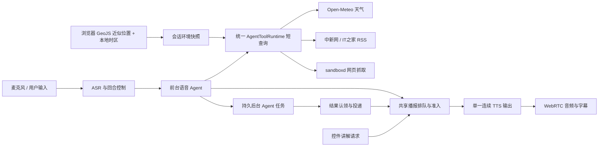

# 全双工语音：18000 生产部署与专用信息源验收

日期：2026-10-21（Asia/Shanghai）。本报告接续 `full-duplex-acceptance-2026-10-21.md`，旧报告保留隔离环境的失败与阶段边界。

## 部署结果

实际入口为 http://127.0.0.1:18000 ，容器 `learngraph-app-1`，最终镜像 `learngraph:voice-information-20261021-final`，镜像 ID `sha256:30eabbd704bdab32a59f4d1af6c1f7436e5df2798264cb301bc60430cc3d17a8`。17:24:35 发布完成，最终复查 healthy、`/api/v1/livez` 返回 200，14 个后端文件哈希与发布清单一致。前端产物实际包含 GeoJS CSP 授权，不再包含 ipwho.is。

保留另一语音任务的 r4 TTS 队列排空修复；经用户授权协调后，其任务已停止重复部署。没有将整个工作区的无关修改打入镜像。最终小版本只增加 `VoiceService.start_task` 两处可选输出契约判空，修复 `capability_id=reasoning` 的 `dict(None)` 500。

Docker 环境、挂载、端口、启动方式和重启策略保持一致，preview / sandboxd / egress-proxy 三个侧车的容器 ID 与启动时间保持不变，原有卷保留。数据库在线备份 `/data/backups/voice-information-20261021-090625.sqlite`，约 4.11 GB，quick_check=ok；回滚镜像及停止状态的旧容器保留。最终发布从停止到健康约 14.2 秒，未宣称零停机。

发布证据：`audit/voice-information-20261021/deployment.json`、`state.json`、`final-verification.json`。

## 融合后的职责边界

前台和后台复用既有执行器、权限及持久消息路径。短天气/新闻查询不必委派后台；复杂任务仍走持久 Agent。控件讲解请求通过独立事件排队，复用统一发声权，不直接与主 TTS 抢音。上下文环境异步更新，不阻塞建立语音连接；回合查询时读取最新快照。

## 专用信息源

| 用途 | 当前选定来源 | 实际验证 |
|---|---|---|
| 客户端近似位置 | 浏览器直接请求 GeoJS | 18000 前端获取城市、地区、国家、近似坐标、IANA 时区并 PATCH 会话成功 |
| 当前及未来天气 | Open-Meteo 地理编码与 Forecast API | 默认位置和指定北京均真实返回，语音真实调用 `get_weather` |
| 综合 / 国际 / 财经新闻 | 中新网官方 RSS | 当前生产容器四分类检查中的三个分类均返回有效近期条目 |
| 科技新闻 | IT之家官方 RSS | 语音真实调用 `get_news`，标题、来源、发布时间和原文链接对应同一条记录 |
| 新闻正文 | 既有 sandboxd FetchProvider | 语音真实调用 `fetch_web_page` 读取 RSS 原文，返回标题和正文 |

默认天气省略 city；若用户指定城市，以指定城市为准。IP 位置使用客户端出口而非服务器出口，不假定本机时区对应城市。浏览器本次时区为 Asia/Shanghai，网络近似城市为 Los Angeles，天气使用 America/Los_Angeles 的当地时间。VPN / 代理会影响推断，所以口头明确说明“网络近似位置”，不宣称真实物理位置。

原始 IP 不发送给 LearnGraph 后端、不持久化；坐标四舍五入到两位小数，只保存所需环境字段。位置源失败或超时返回 unavailable，询问城市；不偷偷改用服务器 IP 或固定城市。原先 ipwho.is 在实际浏览器 Origin 请求中返回限流错误，现已明确选择 GeoJS，不设置多提供方兜底。

天气、新闻均为有界专用工具：固定来源、连接/读取超时、响应大小上限、日期新鲜度检查、参数校验、明确的失败代码。新闻过滤过期/未来异常条目、重复链接和不属于所选来源的链接，不把空结果包装成最新新闻，不在专用源失败时改用 AnySearch 拼凑答案。RSS 只代表所选来源的近期条目，不代表全网新闻覆盖。

来源文档：[Open-Meteo API](https://open-meteo.com/en/docs)、[价格和使用范围](https://open-meteo.com/en/pricing)、[GeoJS 官方仓库](https://github.com/jloh/geojs)、[中新网 RSS](https://www.chinanews.com.cn/rss/)、[IT之家 RSS 公告](https://www.ithome.com/0/000/037.htm)。Open-Meteo 免费端点限非商业使用；商业部署需要 `OPEN_METEO_API_KEY`，代码会明确选择 customer-api，而不是失败后回退免费端点。GeoJS 公共服务没有本项目承诺的 SLA。

## 网页抓取故障定位

此前 18002 隔离测试的 `fetch_provider_failed`，根因是未挂载 sandboxd 凭据目录，具体为 token 文件不可读。18000 的 `/data/sandboxd` 挂载正确，在本次部署前直接抓取 Example Domain 就已成功。因此不能把隔离配置故障误报为生产提供方持续宕机。

修复增加 `FetchRuntimeUnavailable` 类型，将 sandboxd 凭据、运行时或池初始化失败暴露为明确的 `fetch_runtime_unavailable`，不把基础设施缺失伪装成普通页面抓取错误再交给搜索兜底。另修复 Windows 下 fetch 网络策略文件并发读取/替换的竞争：仅保护短文件操作，保留网络抓取并行。

本次生产语音链路读取 `https://www.ithome.com/1/015/991.htm`，`fetch_web_page` started/completed，实际口述标题和原文内容，未调用搜索替代抓取。

## 真实生产链路验收

方法：在实际运行的 `learngraph-app-1` 中建立 aiortc WebRTC，Windows SAPI 合成的 48 kHz PCM 充当麦克风输入；经过当前真实 ASR、LLM、工具提供方、TTS，记录接收 PCM、RTVI、持久 journal 和普通聊天消息。容器内连接 8000 是宿主机 18000 映射的同一生产服务和数据库，没有使用隔离 18002。浏览器另行验证 18000 前端的 IP 环境采集与对话展示。

完整矩阵在 geojs 镜像 `2085bf30…` 上完成；最终镜像 `30eabbd7…` 只追加空契约判空，语音/工具/前端文件保持相同。最终版本另完成默认天气语音复测及 `capability_id=reasoning` 的实际 HTTP 请求、真实 worker 执行、自动播报和落库复核。

| 场景 | 生产证据 / 结果 |
|---|---|
| 默认位置天气 | ASR“我这里现在是什么天气？”→ `get_weather({days:1})`；采用浏览器近似位置洛杉矶并明确口述；完成音频与消息持久化 |
| 指定城市天气 | `get_weather({city:"Beijing",country_code:"CN",days:1})`；正确覆盖 IP 城市并使用北京时间 |
| 科技新闻 | `get_news({category:"technology",limit:2,max_age_hours:48})`；约 1.02 秒完成来源请求；播报两条对应来源条目 |
| 新闻原文 | `fetch_web_page` 完成真实抓取；播报与 RSS 标题一致的原文标题 |
| 主回答中控件讲解 | 252.95 秒提交请求时主音频正在播放；新闻 284.26 秒 finalized 后才受理控件回合；没有打断新闻，没有重叠播报，控件讲解正常持久化 |
| 播放中插话 | 故事播放中注入“停一下，请只说二分查找每次排除一半”；旧回合 interrupted；新回答严格为“二分查找每次排除一半。”，未继续旧故事 |
| 固定填充语 | 本次完整回答未出现固定的“嗯 / 嗯，我想想”；控件讲解以主题相关的“对，前提是数据已经排好序”开始 |
| 空契约后台任务 | 最终版本在宿主 18000 上 POST capability=reasoning、未传 output_contract，返回 HTTP 200；任务 `sa_60e52603-26f4-41` 真实执行并产生结果 |
| 后台结果自动播报 | 上述任务出现 speech.started → speech.finished，playback_status=played；投递回合 user_text 为空；消息表为 user(天气)、assistant(天气)、assistant(后台结果)，未伪造用户消息 |
| 清理 | 本任务 4 个测试语音会话均 ended，runtime_owner 均释放；生产服务仍 healthy，镜像未被其他任务覆盖 |

主要会话：`vs_7bde2083cd2643558fd84061`；最终复测会话：`vs_b475b59f133b45fabb9be098`。可打开的生产对话：<http://127.0.0.1:18000/w/6e37956a-2dd4-4fd7-9774-9589016bbb23/chat/0d792884-e660-4716-b3c7-8ecc725ee81f>。

## 接收音频停顿

20 ms RMS 窗口，RMS < 100 且持续 >=200 ms 计为静音，剔除首尾静音。通过接收端 audio.sample 帧计数映射回合边界，避免将 RTP 空闲期的时间跳变或两回合之间的等待计入句内停顿；保留最终音频尾部。此数据衡量 PCM 内部空隙，不是首响延迟或人工听感评分。

| 录音 | 字幕段数 | 最长内部静音 |
|---|---:|---:|
| 默认天气 | 6 | 520 ms |
| 北京天气 | 7 | 800 ms |
| 科技新闻 | 8 | 640 ms |
| 控件讲解 | 8 | 640 ms |
| 网页原文 | 5 | 560 ms |
| 插话后回答 | 1 | 0 ms（无 >=200 ms 空隙） |

这 6 个样本均未检测到 >800 ms 内部静音，不能由此承诺所有网络、模型或文本下都没有长停顿。

## 测试覆盖

- 与部署基线一致的后端定向回归：94 passed。包含工具目录与权限、取消、失败事件、发声权竞争、环境所有权/校验/刷新保留、天气来源选择、RSS 新鲜度和来源对应、抓取池与并发策略文件。
- 最终空契约修复：4 passed；覆盖 capability=reasoning 的无契约/显式契约及重复请求幂等。部署基线副本再次通过同一 4 项。
- 前端环境与语音生命周期：33 passed；TypeScript 检查与生产构建通过。
- 整个当前工作区较早的宽回归：503 passed、2 failed。两个失败均属于另一个任务未部署的子任务预算行为变更，断言仍期望 PARTIAL；对应部署基线的 worker 测试通过。没有把工作区整体报告为全绿，也没有为通过测试撤销他人修改。

验收探针额外修复了 `pending_` 预留任务链接尚无实际 task 时的轮询问题；早期探针退出日志保留，最终实际任务播报复测完成。生产应用的空契约 500 与探针的预留链接 404 分别记录，没有用探针问题掩盖应用失败。

## 尚未覆盖或未通过的范围

1. 没有使用物理麦克风与扬声器，未验收回声消除、环境噪声、不同声卡和人工听感。
2. 协作任务在同一 geojs 生产服务上的浏览器跨 Docker 媒体测试出现 ICE 失败；当前保留的配置仅有 STUN、没有 TURN relay。因此，本报告不宣称浏览器跨 NAT/Docker 到真实音频设备的全路径验收通过。已验证的是实际生产进程和提供方上的 host↔host WebRTC 音频链路，以及生产前端环境采集/消息展示。详见 `audit/voice-p0-deploy-20261021/browser-ice-failure.json`。
3. IP 只能推断出口近似位置；首次定位失败会询问城市，新闻分类也仅覆盖所选 RSS。
4. 模型的自然表达仍有波动，例如后台结果可能额外描述页面状态；本次证明工具调用、播报互斥、打断和持续音频机制，不将其等同于全面口语质量评估。

## 复查文件

`audit/voice-information-20261021/`：

- `deployment.json` / `state.json` / `final-verification.json`：最终版本、源码哈希、配置保留、会话清理和持久消息。
- `live-probe.log` / `received/voice-information-probe/`：完整场景输入 WAV、接收 WAV、journal、字幕、transcript。
- `final-probe.log` / `received/voice-information-final2-probe/`：最终版本天气和真实后台任务播报。
- `production-reasoning-api.json`：实际 18000 HTTP 200 与任务标识。
- `production-news-sources.json`：生产容器四类 RSS 的实时返回。
- `browser-environment.json`：实际前端 GeoJS 环境快照，无原始 IP。
- `acceptance-summary.json` / `summarize.py` / `received-1.wav` 至 `received-6.wav`：录音片段与可重复测量。
- `deploy-validation-r3.log` / `contract-validation.log` / `frontend-geojs.log` / `typecheck-geojs.log` / `frontend-build-geojs.log`：测试和构建。
- `production-preview.png`：生产 18000 页面截图。
